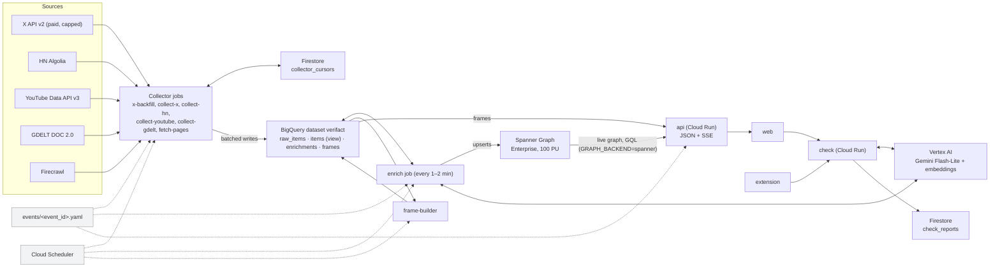

# Architecture

How data moves from public sources to the judges' browser. Decisions behind this are in `project_context/DECISIONS.md` (2026-11-20, late #9–#11) and `PRD.md` (Architecture and stack). Items marked *proposed* are not yet agreed.

## Flow

No queue sits between any stage. Pub/Sub, Memorystore and Dataflow are not used.

## Components
| Component | Runs as | Trigger | Reads | Writes |
| --- | --- | --- | --- | --- |
| `x-backfill` | Cloud Run Job | Manual, once | Config, X API | `raw_items`, cursors |
| `collect-x` | Cloud Run Job | Scheduler, every 15 min (*proposed*) | Config, X API, cursors | `raw_items`, cursors |
| `collect-hn` | Cloud Run Job | Every 10 min (*proposed*) | Config, HN Algolia | `raw_items`, cursors |
| `collect-youtube` | Cloud Run Job | Search hourly, comments every 30 min (*proposed*) | Config, YouTube API | `raw_items`, cursors |
| `collect-gdelt` | Cloud Run Job | Every 15 min (*proposed*) | Config, GDELT | `raw_items`, cursors |
| `fetch-pages` | Cloud Run Job | After new GDELT URLs; official pages daily (*proposed*) | `items`, Firecrawl | `raw_items` |
| `enrich` | Cloud Run Job | Every 1–2 min | `items`, `enrichments`, config, Vertex AI | `enrichments`, Spanner |
| `frame-builder` | Cloud Run Job (*proposed*) | After each `enrich` run, or on demand | `items`, `enrichments` | `frames` |
| `api` | Cloud Run service | HTTP | `frames`, Spanner, BigQuery, config | — |
| `check` | Cloud Run service | HTTP | Vertex AI (+ Search grounding), `items` | Firestore `check_reports` |
| `web` | Static site (host is an open question: Cloud Run or Firebase Hosting) | Browser | `api`, `check` | — |
| `extension` | Chrome MV3 | Right-click | `check` | — |

## Graph backends
- `GRAPH_BACKEND=frames` (default and fallback): the slider and graph read precomputed hourly frames from BigQuery `frames`. The deployed link must work in this mode with every collector off.
- `GRAPH_BACKEND=spanner`: live graph queries (GQL) on `verifact_graph`. Storyline assignment does not use Spanner: `enrich` compares against about 10 centres in memory. Live updates go to the browser over SSE.
- Switching backends must not change any API response shape.

## Switches
| Switch (env) | Off means | Owner flips when |
| --- | --- | --- |
| `LIVE_INGESTION` | Scheduler jobs paused; replay only | More than 50 rejected inserts, or enrichment lag above 15 min |
| `SPANNER_LIVE` | API serves frames | API error rate above 5% for 5 min, or p95 above 2 s |
| `CHECK_ENABLED` | Check page shows cached examples | Gemini spend above $2/day, or over 200 Check requests/hour |
| X spend limit | X collectors stop | $10 reached (X developer console) |

## Environment
All services read: `GCP_PROJECT`, `GCP_REGION` (already chosen and set up), `BQ_DATASET=verifact`, `EVENT_ID` (services) or `--event` (jobs), `GEMINI_MODEL`, `EMBEDDING_MODEL`, `GRAPH_BACKEND`, plus per-service limits. Secrets (X bearer token, YouTube key, Firecrawl key) come from Secret Manager.

## Open questions
- Where is `web` hosted: Cloud Run or Firebase Hosting?
- Are collector cadences confirmed?
